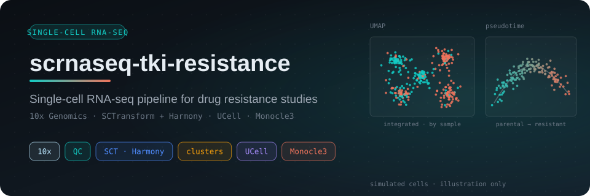
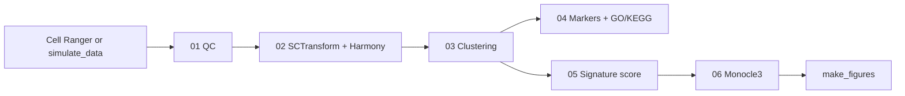
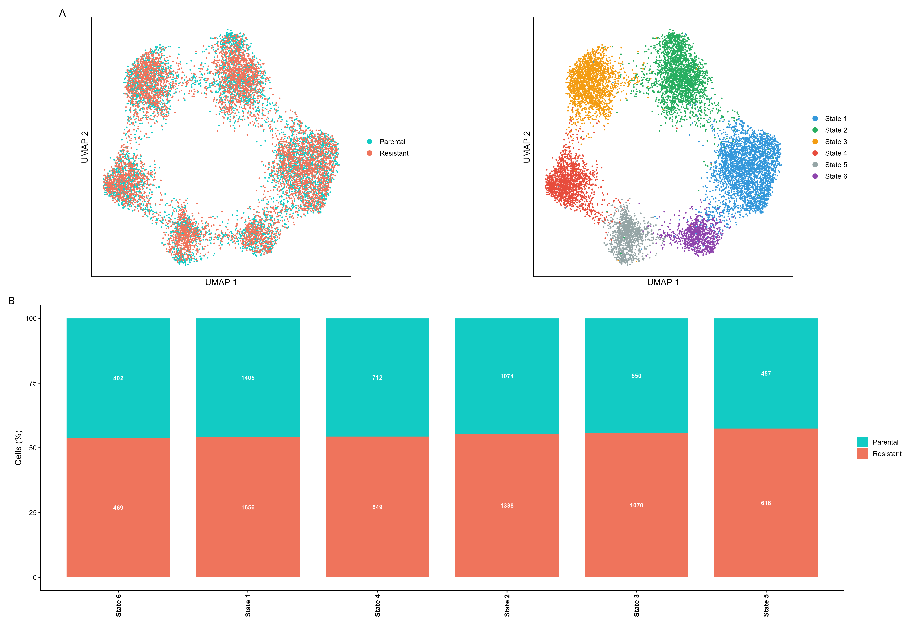
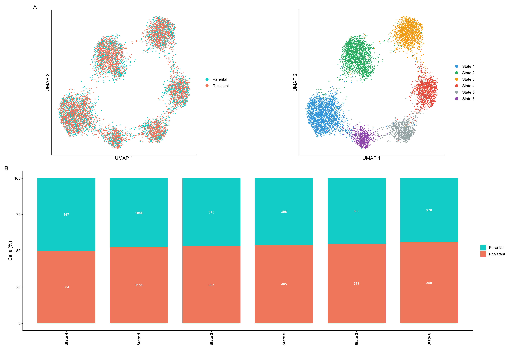
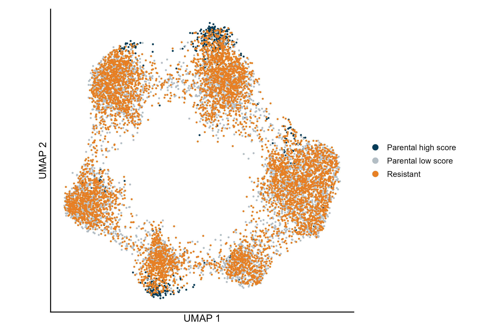
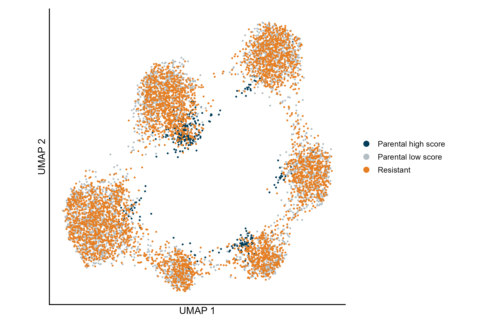
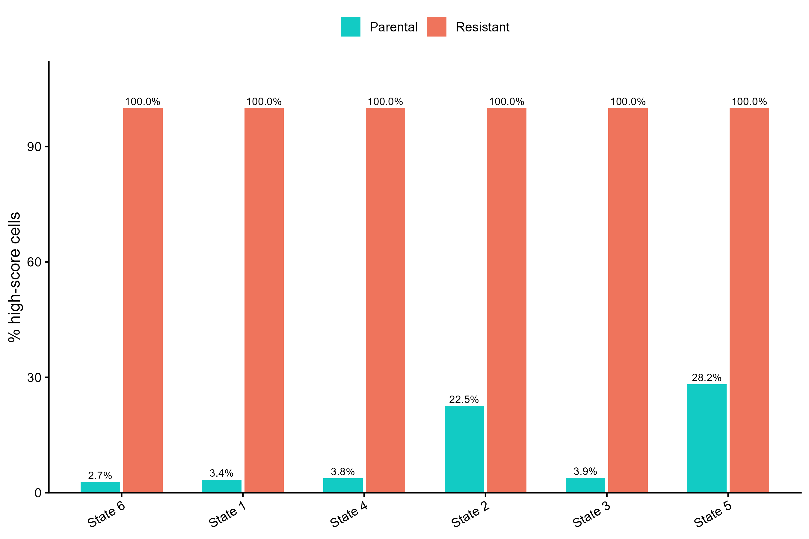
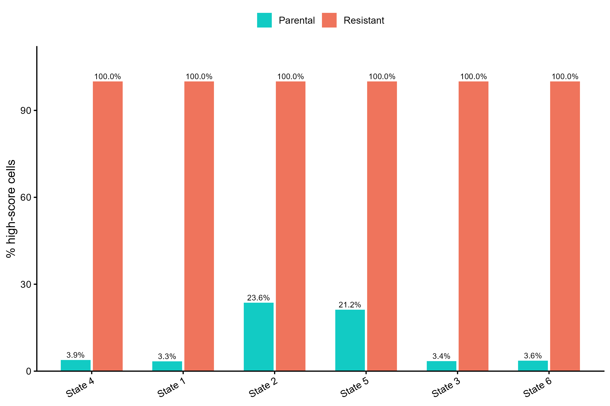
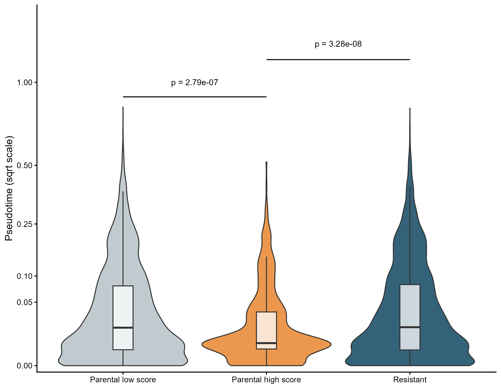
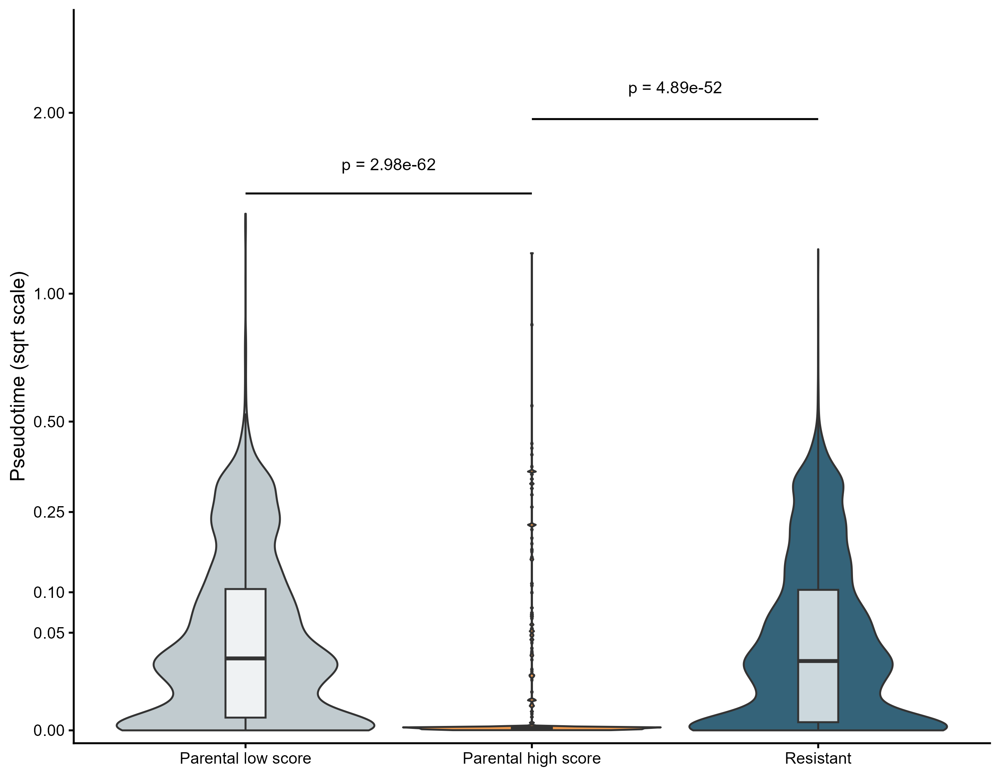

<div align="center">



# Single-cell RNA-seq — TKI Resistance Transcriptomics in NSCLC


[Objective](#objective) · [Pipeline](#pipeline) · [Quick start](#quick-start) · [Example output](#example-output) · [Adding a model](#adding-a-model) · [Repository structure](#repository-structure) · [References](#references)

</div>

---

## Objective

When a lung cancer cell line becomes resistant to a tyrosine kinase inhibitor, is the resistant state a new transcriptional program, or was it already present as a rare subpopulation of the parental cells?

The pipeline compares a parental and a resistant sample profiled with 10x Genomics. It integrates the two samples, clusters the cells, scores every cell for a resistance signature derived from bulk RNA-seq, and orders the cells along a trajectory. Parental cells that already score high for the signature, and where they sit among the states and along the trajectory, are the readout for pre-existence.

Two groups are configured, one per driver receptor: **MET** (samples `MET1` / `MET1R`) and **EGFR** (`EGFR1` / `EGFR1_R`). The repository ships **no real data**: a simulator produces fictitious 10x-style data so that every step, and every figure below, can be reproduced by anyone.

---

## Pipeline



| Step | Script | What it does | Checkpoint |
|------|--------|--------------|------------|
| — | `simulate_data.R` | Fictitious 10x-style data and signature for a group | `<GROUP>/data/` |
| 01 | `sc_01_qc.R` | QC and filtering per sample | `<sample>_filtered.rds` |
| 02 | `sc_02_normalize_integrate.R` | SCTransform per sample, Harmony on sample, PCA, UMAP | `<GROUP>_integrated.rds` |
| 03 | `sc_03_clustering.R` | Louvain clustering at several resolutions, marker-gene panels | `<GROUP>_clustered.rds` |
| 04 | `sc_04_markers_all.R` | Markers per cluster, GO/KEGG enrichment, pre-existence table | `<GROUP>_de_results.rds` |
| 05 | `sc_05_signature.R` | UCell and module scores of the bulk-derived signature | `<GROUP>_signature.rds` |
| 06 | `sc_06_monocle3.R` | Trajectory, pseudotime and graph test | `<GROUP>_trajectory.rds` |
| 06b | `sc_06b_monocle3_no_graphtest.R` | Same as 06 without the slow graph test | same |
| — | `make_figures.R` | Four clean summary figures | `results/<GROUP>/` |

Design choices worth knowing:

- Harmony corrects by **sample** (technical run effect), never by condition, so the parental/resistant difference is preserved.
- Each sample is normalised separately with SCTransform before merging, and cell-cycle scores are regressed out by default (`REGRESS_CELL_CYCLE`).
- Every step from 03 on has a `RERUN_VIZ_ONLY` switch that loads the saved checkpoint and regenerates only figures and reports.
- A high signature score in a parental cell only describes the score distribution (the cut-off is a percentile, `HIGH_SCORE_PCTL`). Pre-existence has to be argued from where those cells sit among the states and along the trajectory, not from the fraction above the cut-off.

---

## Quick start

R 4.3 or later. **Open R inside the repository**: every script calls `setwd(here::here())` and the root is fixed by the `.here` file.

```r
# Main packages: Seurat 5, SeuratWrappers, harmony, UCell, monocle3, presto, glmGamPoi,
# clusterProfiler, org.Hs.eg.db, clustree, ggridges, pheatmap, ggrepel, patchwork,
# ggplot2, dplyr, tibble, tidyr, RColorBrewer, here, R.utils

GROUP <- "MET"                                  # or "EGFR"
source("scripts/simulate_data.R")               # fictitious data (skip it if you have real data)
# In each script below, set GROUP in its CONFIGURATION block and run in order
source("scripts/sc_01_qc.R")
source("scripts/sc_02_normalize_integrate.R")
source("scripts/sc_03_clustering.R")
source("scripts/sc_04_markers_all.R")
source("scripts/sc_05_signature.R")
source("scripts/sc_06_monocle3.R")
source("scripts/make_figures.R")                # uses GROUP; figures go to results/<GROUP>/
```

Every script keeps its `GROUP` and `RERUN_VIZ_ONLY` in a CONFIGURATION block at the top. `RERUN_VIZ_ONLY <- TRUE` loads the saved checkpoint and redraws only the figures. With real data, place the Cell Ranger output in `<GROUP>/data/<sample>/filtered_feature_bc_matrix/` and a signature CSV (columns `Gene` and `Classification`, `Upregulated` / `Downregulated`) in `<GROUP>/data/signatures/<GROUP>_resistance_signature_conservative.csv`.

`make_figures.R` can also read the checkpoints of another project folder (`RESULTS_ROOT`), name the states from the config (`USE_STATE_NAMES <- TRUE`) or write somewhere else (`OUT_DIR`); see its header.

---

## Example output

All figures below come from the pipeline run on the **fictitious data** of `simulate_data.R` (about 5,000 cells per sample, 4,000 genes, a planted resistance program present in a small parental subpopulation). They show what each step produces, not biology. States are named generically.

**UMAPs by sample and state, and composition of each state**

| MET | EGFR |
|:---:|:---:|
|  |  |

**Parental cells with a high signature score, on the UMAP**

| MET | EGFR |
|:---:|:---:|
|  |  |

**Percentage of high-score cells per state and sample**

| MET | EGFR |
|:---:|:---:|
|  |  |

**Pseudotime per group (Wilcoxon tests, square-root axis)**

| MET | EGFR |
|:---:|:---:|
|  |  |

---

## Adding a model

The code is driven by `config/pipeline_config.R`. To add another receptor or model:

1. Add its samples to `SAMPLES`, its conditions to `CONDITIONS` and its colours to `SAMPLE_COLORS`.
2. Add its QC thresholds to `QC_PARAMS` and its gene panels (`GENES_RESISTANCE_PANEL`, `GENES_KEY_SIGNATURE`, `GENES_DTP`).
3. Optionally name the transcriptional states in `CLUSTER_LABELS` once `sc_04` has shown what each cluster is.
4. Set `GROUP` to the new name in the CONFIGURATION block of each script.

---

## Repository structure

```
config/        pipeline_config.R · gene_lists.R · colors.R
scripts/       simulate_data.R · sc_01 … sc_06b · make_figures.R
results/       figures of the example run (versioned)
<GROUP>/data/  input (not versioned)       <GROUP>/results/  pipeline output (not versioned)
```

---

## References

- Hao Y et al. (2021). Integrated analysis of multimodal single-cell data. *Cell* 184(13):3573–3587.
- Korsunsky I et al. (2019). Fast, sensitive and accurate integration of single-cell data with Harmony. *Nature Methods* 16:1289–1296.
- Choudhary S, Satija R (2022). Comparison and evaluation of statistical error models for scRNA-seq. *Genome Biology* 23:27.
- Andreatta M, Carmona SJ (2021). UCell: robust and scalable single-cell gene signature scoring. *Computational and Structural Biotechnology Journal* 19:3796–3798.
- Cao J et al. (2019). The single-cell transcriptional landscape of mammalian organogenesis. *Nature* 566:496–502.
- Yu G et al. (2012). clusterProfiler: an R package for comparing biological themes among gene clusters. *OMICS* 16(5):284–287.
