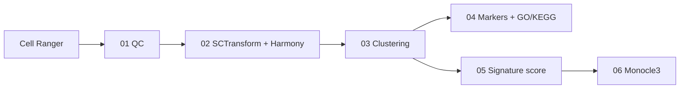

<div align="center">


# Single-cell RNA-seq — TKI Resistance Transcriptomics in NSCLC


[Objective](#objective) · [Pipeline](#pipeline) · [Running it](#running-it) · [Data format](#data-format) · [Repository structure](#repository-structure) · [References](#references)

</div>

---

## Objective

When a lung cancer cell line becomes resistant to a tyrosine kinase inhibitor, is the resistant state a new transcriptional program, or was it already present as a rare subpopulation of the parental cells?

This pipeline compares a parental and a resistant sample profiled with 10x Genomics, one pair per driver receptor (MET and EGFR). It integrates the two samples, clusters the cells, scores every cell for a resistance signature derived from bulk RNA-seq, and orders cells along a trajectory. Parental cells that already score high for the signature, and where they fall along the trajectory, are the readout for pre-existence.

The sample names are generic: `MET1` / `MET1R` and `EGFR1` / `EGFR1_R` (parental / resistant). Nothing in this repository is real data or a real result.

---

## Pipeline



| Step | Script | What it does | Checkpoint |
|------|--------|--------------|------------|
| 01 | `sc_01_qc.R` | QC and filtering per sample | `<sample>_filtered.rds` |
| 02 | `sc_02_normalize_integrate.R` | SCTransform per sample, Harmony on sample, PCA, UMAP | `<GROUP>_integrated.rds` |
| 03 | `sc_03_clustering.R` | Louvain clustering at several resolutions, marker-gene panels | `<GROUP>_clustered.rds` |
| 04 | `sc_04_markers_all.R` | Markers per cluster, GO/KEGG enrichment, pre-existence table | `<GROUP>_de_results.rds` |
| 05 | `sc_05_signature.R` | UCell and module scores for the bulk-derived signature | `<GROUP>_signature.rds` |
| 06 | `sc_06_monocle3.R` | Trajectory, pseudotime and graph test | `<GROUP>_trajectory.rds` |
| 06b | `sc_06b_monocle3_no_graphtest.R` | Same as 06 without the slow graph test | same |

Design choices worth knowing:

- Harmony corrects by **sample** (technical run effect), never by condition, so the parental/resistant difference is preserved.
- Each sample is normalised separately with SCTransform before merging.
- Cell-cycle scores are computed and, by default, regressed out (`REGRESS_CELL_CYCLE`).
- Every step from 03 on has a `RERUN_VIZ_ONLY` switch that loads the saved checkpoint and regenerates only figures and reports.
- A high signature score in a parental cell is only a statement about the score distribution (the threshold is a percentile, `HIGH_SCORE_PCTL`). Pre-existence has to be argued from where those cells sit in the clusters and the trajectory, not from the fraction above the threshold.

---

## Example output

All figures below come from the pipeline run on **simulated data** (two samples of 1,500 cells, 3,000 genes, a planted resistance program present in a few percent of the parental cells). They show what each step produces, not biology. The state names are placeholders.


| | |
|---|---|
| <br>**Transcriptional states** (`sc_04`): UMAP on the Harmony space, one colour per annotated state. | <br>**Clusters and sample of origin** (`sc_03`): the two samples overlap inside shared clusters while sample-specific clusters stay separate. |
| <br>**Pre-existence view** (`sc_05`): parental cells with a high resistance score (dark) next to parental low-score and resistant cells. | <br>**Composition** (`sc_03`): share of each sample in every cluster, with absolute cell counts. |
| <br>**Signature landscape** (`sc_05`): UCell score of the up-regulated genes against the down-regulated genes, per cell. | <br>**Trajectory** (`sc_06`): Monocle3 graph over the Harmony UMAP, rooted in the parental cells. |

---

## Running it

R 4.3 or later. **Open R inside the repository**: each script calls `setwd(here::here())` and the root is fixed by the `.here` file.

```r
# Main packages: Seurat 5, SeuratWrappers, harmony, UCell, monocle3, presto, glmGamPoi,
# clusterProfiler, org.Hs.eg.db, clustree, ggridges, pheatmap, ggrepel, patchwork,
# ggplot2, dplyr, tibble, tidyr, RColorBrewer, here
# 1. In each script, edit the CONFIGURATION block: GROUP ("MET" or "EGFR") and RERUN_VIZ_ONLY
# 2. Run in order
source("scripts/sc_01_qc.R")
source("scripts/sc_02_normalize_integrate.R")
source("scripts/sc_03_clustering.R")
source("scripts/sc_04_markers_all.R")
source("scripts/sc_05_signature.R")
source("scripts/sc_06_monocle3.R")
```

Parameters that vary by dataset (QC thresholds, number of PCs, gene panels, cluster annotations, colours) live in `config/pipeline_config.R`, `config/gene_lists.R` and `config/colors.R`. To add a dataset, add one entry to each list in `pipeline_config.R`.

**Requirements and status.** Both groups were run end to end (`sc_01` to `sc_06`; `sc_06b` on MET) on simulated 10x-style data: two samples of 1,500 cells per group, 3,000 genes, a planted resistance program present in a few percent of the parental cells. No real data is shipped. Notes from those runs:

- With so few genes some cell-cycle markers are absent and Seurat warns; with real data this does not happen.
- The optional `.h5ad` export at the end of `sc_02` needs `SeuratDisk` and fails with a warning on recent SeuratObject versions. It is wrapped in `tryCatch`, so the pipeline continues; nothing downstream reads it.
- GO/KEGG enrichment (`sc_04`) needs internet access for KEGG and returned no significant terms on the simulated genes; the enrichment figures then show an empty panel, by design.
- The HTML reports of the original analysis are not part of this repository: every step writes a Markdown report.

`CLUSTER_LABELS` is empty by default. After `sc_04`, fill it in with the transcriptional state of each cluster and re-run `sc_04` and `sc_05` with `RERUN_VIZ_ONLY <- TRUE` to get the annotated figures.

---

## Data format

Nothing is versioned except the format description. See [`MET/data/README.md`](MET/data/README.md).

```
MET/data/MET1/filtered_feature_bc_matrix/       Cell Ranger output, parental
MET/data/MET1R/filtered_feature_bc_matrix/      Cell Ranger output, resistant
MET/data/signatures/MET_resistance_signature_conservative.csv
```

The signature is a CSV with the columns `Gene` and `Classification` (`Upregulated` / `Downregulated`), typically the output of a bulk RNA-seq comparison of the resistant and parental populations.

---

## Repository structure

```
config/        pipeline_config.R · gene_lists.R · colors.R
scripts/       sc_01 … sc_06b
MET/data/      input (not versioned)       MET/results/    output (not versioned)
EGFR/data/     input (not versioned)       EGFR/results/   output (not versioned)
```

Each script writes figures (PNG), tables (CSV), a Markdown report and its checkpoint under `<GROUP>/results/`.

---

## References

- Hao Y et al. (2021). Integrated analysis of multimodal single-cell data. *Cell* 184(13):3573–3587.
- Korsunsky I et al. (2019). Fast, sensitive and accurate integration of single-cell data with Harmony. *Nature Methods* 16:1289–1296.
- Choudhary S, Satija R (2022). Comparison and evaluation of statistical error models for scRNA-seq. *Genome Biology* 23:27.
- Andreatta M, Carmona SJ (2021). UCell: robust and scalable single-cell gene signature scoring. *Computational and Structural Biotechnology Journal* 19:3796–3798.
- Cao J et al. (2019). The single-cell transcriptional landscape of mammalian organogenesis. *Nature* 566:496–502.
- Yu G et al. (2012). clusterProfiler: an R package for comparing biological themes among gene clusters. *OMICS* 16(5):284–287.
